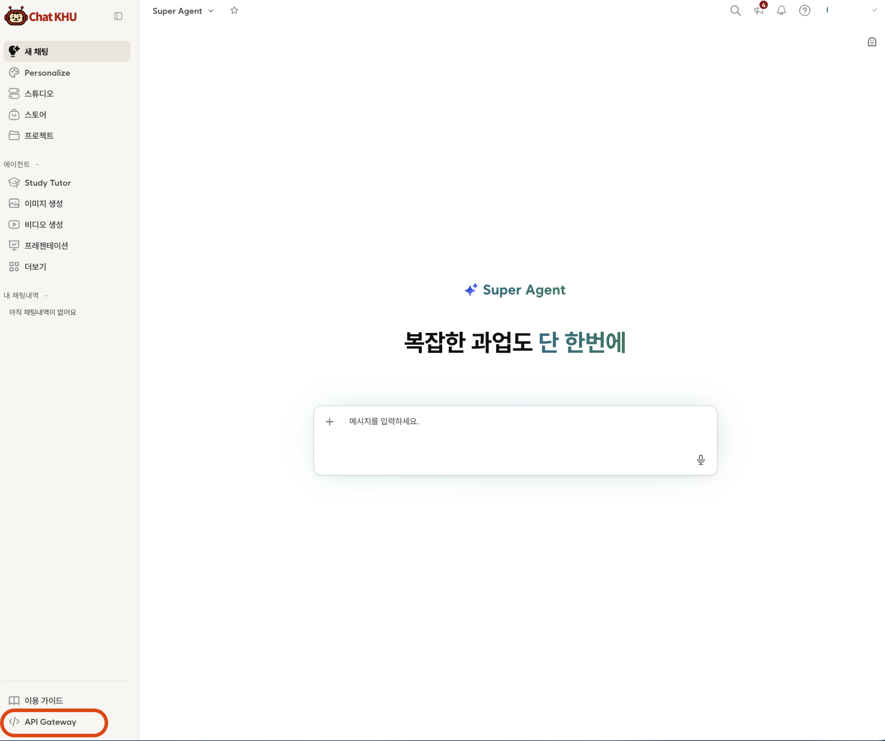
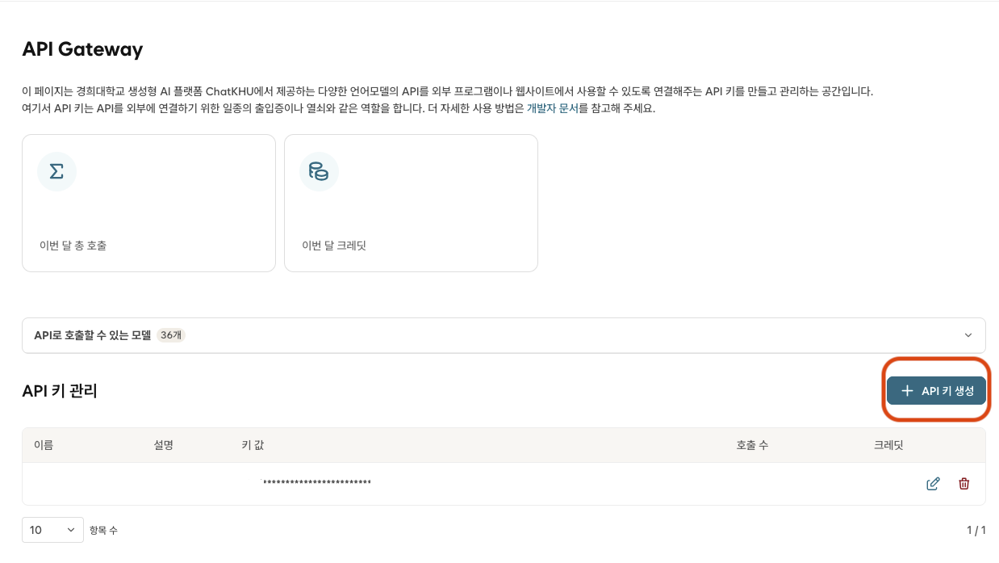
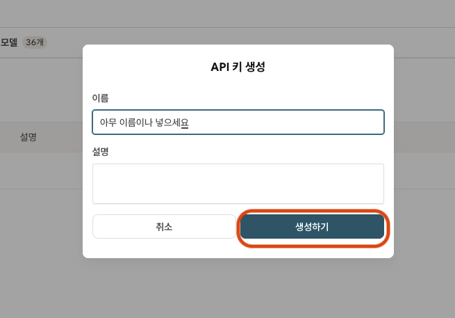
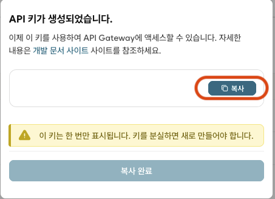

# KHU_LLM

경희대학교 학부·대학원 학생과 교수·교직원을 위한 ChatKHU 데스크톱 AI 워크스페이스입니다. 본인의 ChatKHU API 키 하나로 대화, 모델 비교, 문서 기반 대화, 이미지·오디오·비디오 생성, 선택한 폴더에서 파일을 읽고, 고치고, 새로 만드는 코딩 작업까지 사용할 수 있습니다. 로그인할 때 고른 신분과 학과에 맞춰 시작 화면과 템플릿, 기본 지침이 준비됩니다.

이 저장소는 설치 파일과 릴리즈 노트를 배포하는 곳입니다. 앱의 소스 코드는 공개하지 않습니다.

## 주요 기능

- 신분(학부생·대학원생·교수·교직원)과 소속(캠퍼스 → 단과대학·대학원 → 학과·전공)에 맞춘 첫 화면, 시작 템플릿, 기본 지침
- ChatKHU Gateway가 현재 계정에 허용한 채팅·미디어 모델 선택, 최대 3개 모델 답변 비교
- Gemini·Sonar의 직접 웹 검색과 그 밖의 모델을 위한 Sonar 검색 연동
- 이미지 생성, 음성 합성·받아쓰기·음악, 비디오 생성, 받아쓰기 결과의 회의록 요약
- PDF·DOCX·XLSX·PPTX·HWPX·TXT·MD·CSV·이미지 첨부와 문서 내용 기반 대화
- 연구별 지침과 문서를 묶는 프로젝트, 논문·법령 리서치, ChatKHU Studio 챗봇
- 코딩 작업 공간: 폴더를 열고 요청하면 모델이 파일을 읽고 고치거나 새로 만드는 변경을 제안합니다(빈 폴더에서도 시작 가능). 파일마다 변경 내용을 확인해 적용하고 체크포인트로 되돌립니다. 권한 모드(묻기·편집 자동·계획)로 확인 방식을, 모델 옆에서 사고 강도(자동·낮음·중간·높음 등, 모델에 따라 다름)를 고르고, 셸 명령은 설정에서 직접 켜야 하며 승인한 것만 실행됩니다. git 저장소 만들기·복제와 브랜치 만들기·전환·커밋은 항상 승인합니다.
- 운영체제 보안 저장소를 이용한 API 키 보호, 기기 안에 암호화해 보관하는 대화 기록, 암호로 보호하는 백업·복원
- macOS Intel·Apple Silicon 및 Windows 지원

## 설치

[최신 버전 내려받기](https://github.com/airkjw/KHU_LLM-releases/releases/latest)에서 아래 파일 중 사용하는 컴퓨터에 맞는 것을 받아 설치합니다.

| 운영체제 | 파일 |
| --- | --- |
| macOS Apple Silicon | `KHU_LLM-<버전>-arm64.dmg` |
| macOS Intel | `KHU_LLM-<버전>.dmg` |
| Windows x64 | `KHU_LLM-<버전>-x64-Setup.exe` |

- `.zip`·`.blockmap`·`.yml` 파일은 자동 업데이트용이라 받을 필요가 없습니다.
- macOS 앱은 Developer ID 서명과 Apple 공증을 거칩니다.
- Windows 설치 파일에는 별도의 코드 서명(Authenticode)이 적용되지 않아, 설치할 때 Windows SmartScreen 등의 경고가 나타날 수 있습니다.

## ChatKHU API 키 발급 방법

1. [ChatKHU 로그인 페이지](https://chat.khu.ac.kr/auth)에 접속해 Info21 아이디와 비밀번호로 로그인합니다.

2. 로그인 후 왼쪽 아래의 **API Gateway**를 클릭합니다.

   

3. API 키 관리 화면에서 **+ API 키 생성**을 누릅니다.

   

4. API 이름을 입력하고 **생성하기**를 누릅니다. 설명은 필요할 때 입력하면 됩니다.

   

5. API 키가 생성되면 **복사**를 눌러 메모장 등 안전한 곳에 보관합니다. 이 키는 한 번만 표시되며, 잃어버리면 새로 만들어야 합니다. 복사한 API 키가 KHU_LLM의 로그인 키가 됩니다.

   

## 개인정보 안내

- **API 키**: 앱에 입력한 API 키는 이 기기의 운영체제 보안 저장소로 보호됩니다.
- **첨부 자료**: 파일을 처음 첨부할 때 "개인정보·민감정보를 제거하셨습니까?"라는 확인 창이 대화별로 한 번 나타납니다. 앱이 개인정보를 자동으로 탐지하거나 제거하지 않으므로 전송 전에 직접 제거해야 합니다.
- **미디어 생성**: 첨부 자료가 없어도 "개인정보·민감정보를 제거한 자료만 전송합니다"를 체크해야 시작할 수 있습니다.
- **선택한 신분·소속**: 기본 지침에 포함되어 ChatKHU API로 전송됩니다. 학번·이름·이메일은 입력받지 않으며, 신분과 소속만 이 기기에 암호화해 보관합니다.
- **질문과 음성**: 입력한 질문과 음성 기능의 마이크 음성은 ChatKHU API를 거쳐 선택한 모델 제공사로 전송됩니다. 원본 음성은 저장하지 않습니다.
- **코딩**: 요청, 작업 폴더 맨 위와 모델이 열어 본 폴더의 파일·폴더 이름 목록, 모델이 읽거나 검색한 파일 내용, 승인한 명령의 출력(셸 출력은 비밀 값처럼 보이는 줄을 가린 뒤), git 상태·변경 내용·커밋 기록(커밋 메시지와 작성자 이름), 이 컴퓨터의 개발 도구 버전(Node·npm·Python·git·셸)이 ChatKHU API를 거쳐 선택한 모델 서버로 전송되고, 모델 호출마다 크레딧이 사용됩니다. 개인정보·민감정보가 든 파일은 작업 폴더에 두지 말고, 파일 이름에도 개인정보를 넣지 마세요. 비밀 값이 들어 있을 수 있는 파일은 동의해야 전송되고, 비밀 값 가림은 보조 장치입니다. 명령·셸 실행은 설정에서 직접 켜야 하며 승인한 명령은 내 계정 권한으로 실행됩니다. git 저장소 만들기·복제, 브랜치 만들기·전환, 커밋은 항상 승인합니다.
- **기기 안의 기록**: 대화 기록과 코딩 작업 기록(저장된 명령 출력 포함)은 이 기기에 암호화해 보관합니다.

## 자동 업데이트

앱은 이 저장소의 릴리즈에서 새 버전을 확인하고 업데이트합니다. 0.1.0을 설치한 경우에는 옛 배포 위치를 확인하므로 자동으로 업데이트되지 않습니다. 0.1.0 앱에서는 업데이트 확인이 실패해 계정 아이콘에 '오류' 표시가 보일 수 있으니, 다시 시도하지 말고 [최신 버전](https://github.com/airkjw/KHU_LLM-releases/releases/latest)을 한 번 직접 내려받아 설치해 주세요.

## 소스 코드

KHU_LLM의 소스 코드는 비공개입니다. 이 저장소에는 설치 파일과 릴리즈 노트, 안내 문서만 있습니다.
